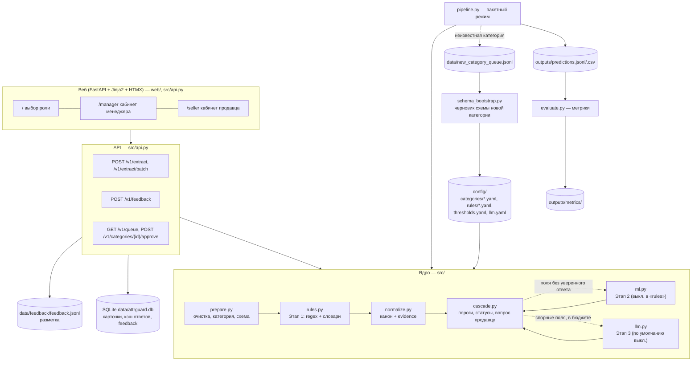

# Архитектура AttrGuard

> Зачем и что — [INTENT.md](INTENT.md); требования и правила — [SPEC.md](SPEC.md); принятые решения — [DECISIONS.md](DECISIONS.md).
> Здесь — как устроена система сейчас и где что лежит.

## 1. Идея в одном абзаце

Карточка товара (`title`, `description`, `seller_attributes`) проходит **каскад** от дешёвого к дорогому:
правила и словари → лёгкий ML → LLM. Каждый следующий этап получает **только** поля, которые предыдущий не решил уверенно.
После каждого этапа значение нормализуется к канону и проверяется, что оно **реально есть в тексте** (evidence со смещениями).
На выходе у каждой характеристики есть значение, статус, уверенность, этап и подтверждающий фрагмент; по статусам
внешняя система решает: применить автоматически, показать менеджеру или спросить продавца.

## 2. Компоненты

## 3. Путь одной карточки

1. **Шаг 0 — `prepare.prepare(card, schemas)`**
   - категория: `category_hint`, если такая схема есть; иначе ключевые слова схем в `title`, затем в `description`;
     не нашли → `unknown` + общие атрибуты из `config/categories/_common.yaml` (бренд, цвет);
   - схема категории: список атрибутов с типом (`enum` / `number`), единицей, справочником `values`, `seller_keys`, `range`;
   - `source_texts(card)` — три исходных текста (`title`, `description`, `seller_attributes` в виде строк «ключ: значение»),
     на них ссылаются все evidence; `text_hash` — sha256 для идемпотентности.
2. **Этап 1 — `rules.extract(prepared)`** → список `Candidate` со span в исходном тексте:
   словари синонимов из `config/rules/*.yaml` (модель → бренд, «серый космос» → Серый, DOS → Без ОС …) и регулярки
   «число + единица» с контекстом (ОЗУ против накопителя, «8/256GB», «microSD до 1 ТБ», видеопамять, «81 см», `55"` …).
   Базовая уверенность: словарь 0,95, регулярка 0,85, нечётко 0,6 — с поправками за контекст.
3. **`normalize.normalize(candidate, spec)`** — канон: число без единицы (`"8"`, `"6.67"`, 1 ТБ = `"1024"` GB), enum —
   только из справочника; значение вне справочника/диапазона → `None`. `check_evidence` → `evidence_is_valid`.
4. **`cascade.Cascade.run(card)`** — группировка кандидатов по атрибуту и статус (SPEC 3.4):

   | Условие | Статус |
   |---|---|
   | нет кандидата с валидной evidence | `missing` + вопрос продавцу |
   | разные каноны из разных источников, оба выше порога `low` | `conflict` + вопрос с вариантами |
   | лучший ≥ порога `high` и совпадает со значением продавца в каноне | `unchanged` |
   | лучший ≥ порога `high` | `proposed` |
   | иначе | `low_confidence` (показать менеджеру) |

   Этап 2 (`config rules_ml`) вызывается для `missing` / `low_confidence` / `conflict`; Этап 3 (`full`) — для `conflict` /
   `low_confidence` и в пределах лимита вызовов. Значение от LLM — максимум `low_confidence`.
   Статус карточки (по обязательным полям): всё `unchanged`/`proposed` → `ready`; есть `conflict`/`missing` →
   `needs_seller`; иначе → `needs_manager`.
5. **Ответ — `ExtractResponse`** (`src/contracts.py`): `product_id, category, category_confidence, attributes[], card_status,
   llm_calls, elapsed_ms, text_hash`; каждый `AttributeResult`: `attribute, was, value, unit, status, confidence, stage,
   evidence{text,start,end,source}, question_to_seller{text, options}`.

**Инвариант, который проверяют тесты:** `proposed`/`unchanged` только при `source_texts(card)[source][start:end] == evidence.text`.

## 4. Модули

| Модуль | Ответственность | Ключевые точки входа |
|---|---|---|
| `src/contracts.py` | замороженный контракт (меняет только оркестратор) | `Card`, `Candidate`, `Evidence`, `AttributeResult`, `ExtractResponse`, `source_texts`, `evidence_is_valid` |
| `src/prepare.py` | загрузка схем (кэш по mtime, `*.draft.yaml` пропускаются), категория, хэш | `load_schemas`, `detect_category`, `prepare` |
| `src/rules.py` | Этап 1 | `extract` |
| `src/normalize.py` | канон, словари синонимов, evidence | `normalize`, `check_evidence` |
| `src/cascade.py` | оркестрация, пороги (`config/thresholds.yaml`, override по атрибуту/категории), статусы, вопросы | `Cascade`, `CascadeConfig`, `extract` |
| `src/ml.py` | Этап 2 (сейчас `NullML`) | `MLStage.predict`, `train` |
| `src/llm.py` | Этап 3: `NullLLM`, `HttpLLM` (openai-совместимый / GigaChat / YandexGPT), кэш, лимит, проверка цитат | `load_llm`, `LLMClient.resolve`, `complete_json` |
| `src/schema_bootstrap.py` | очередь «новая категория», черновик схемы (LLM или эвристика) | `NewCategoryQueue`, `bootstrap_schema`, `save_draft` |
| `src/pipeline.py` | пакетный режим, форматы `.jsonl/.json/.csv/каталог` | `python -m src.pipeline` |
| `src/evaluate.py` | P/R/F1, coverage, precision(proposed), взвешенный F1, сравнение конфигураций, стоимость порога | `python -m src.evaluate`, `best_thresholds`, `calibrate_thresholds` |
| `src/api.py`, `src/storage.py`, `web/` | API, SQLite, веб-кабинеты | `uvicorn src.api:app` |

## 5. Конфигурация и данные

| Путь | Что | Кто меняет |
|---|---|---|
| `config/categories/<code>.yaml` | схема категории: атрибуты, типы, единицы, справочники, `seller_keys` | EDA / менеджер (утверждение черновика) |
| `config/categories/<code>.draft.yaml` | черновик схемы новой категории (не грузится в каскад) | `schema_bootstrap` |
| `config/rules/<attr>.yaml` | словари синонимов «вариант → канон» | разработчик (скилл `add-rule`), петля feedback |
| `config/thresholds.yaml` | пороги `high`/`low` по умолчанию и по атрибутам; параметры стоимости (₽/ч, минуты на поле, цена ошибки) | калибровка на validation |
| `config/llm.yaml` | провайдер, модель, лимит вызовов, кэш; `enabled: false` | команда |
| `data/raw/` | датасет кейса (не в git) | аналитик |
| `data/attrguard.db` | SQLite: карточки, кэш ответов по `product_id + text_hash`, feedback | API |
| `data/feedback/feedback.jsonl` | ответы продавцов и решения менеджеров — разметка для словарей и Этапа 2 | API |
| `data/new_category_queue.jsonl` | карточки неизвестных категорий | pipeline (`--new-category-queue`) |
| `outputs/` | предсказания, метрики, скриншоты UI | pipeline / evaluate |

## 6. Петли развития

- **Новая категория (INTENT 4.2).** `pipeline --new-category-queue` → накопилось ≥ 20 карточек →
  `python -m src.schema_bootstrap --queue … --category <code>` → `config/categories/<code>.draft.yaml` →
  менеджер правит и утверждает в `/manager/categories` (файл переименовывается в `.yaml`) → схема сразу подхватывается
  каскадом (кэш схем по mtime). Дальше — словари (`add-category`).
- **Feedback (INTENT 4.3).** Действия «Принять / Исправить / Ответ продавца» → `POST /v1/feedback` → SQLite +
  `feedback.jsonl`. Новые варианты написания → в `config/rules/*.yaml`; накопленные примеры → обучение Этапа 2.
- **Пороги (INTENT 5.2).** `evaluate.calibrate_thresholds` на validation минимизирует
  `доля_человеку × цена_ручной_проверки + доля_ошибок × цена_ошибки` по атрибутам → `config/thresholds.yaml`.

## 7. Конфигурации каскада

| `--config` | Этапы | Когда |
|---|---|---|
| `rules` | Шаг 0 + Этап 1 | по умолчанию; онлайн-вызов < 1 с |
| `rules_ml` | + Этап 2 | после обучения `ml.py` |
| `full` | + Этап 3 | при `enabled: true` и `LLM_API_KEY`; иначе работает как `rules_ml` |

## 8. Развёртывание

- **Colab / локально:** `pip install -r requirements.txt`; пакет — `python -m src.pipeline …`; веб — `uvicorn src.api:app`.
- **Демо наружу:** `cloudflared tunnel --url http://localhost:8000` (из Colab).
- Внешних сервисов нет: SQLite и файлы; HTMX лежит в `web/static/`. Ключ LLM — только из `LLM_API_KEY`.

## 9. Тесты

- `tests/fixtures/*.json` — 26 эталонных карточек с трудными случаями; `tests/test_fixtures.py` гоняет каскад по ним.
- `tests/test_no_proposed_without_evidence.py` — инвариант evidence.
- Модульные: `test_rules.py`, `test_cascade.py`, `test_pipeline.py`, `test_evaluate.py`, `test_llm.py`,
  `test_schema_bootstrap.py`, `test_api.py` (оба сценария SPEC 4.5 через HTTP).
- Браузер: `tests/e2e/ui_scenarios.py` (Playwright, не входит в pytest).
